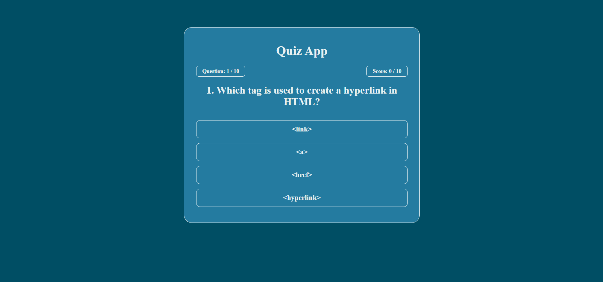
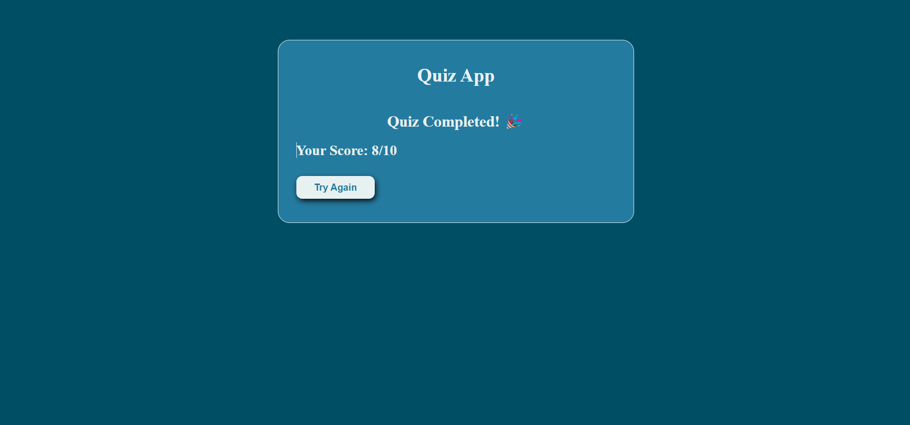

<<<<<<< HEAD
# Quiz App 🎯

A simple and responsive Quiz Application built using **HTML**, **CSS**, and **JavaScript**.  
This app displays multiple-choice questions, tracks the user's score, highlights correct and incorrect answers, and shows the final results with an option to **try again**.

## 🛠 Features

- Display multiple-choice questions
- Highlight correct (green) and wrong (red) answers
- Score and question number update automatically
- Responsive design (works well on mobiles and desktops)
- "Next" button appears after selecting an answer
- Final result page with "Try Again" button to restart the quiz

## 📸 Screenshots

| Quiz Screen | Final Score Screen |
|:-----------:|:------------------:|
|  |  |

## 🚀 Getting Started

### Clone the repository
```bash
git clone https://github.com/CodeWithShambhu/quiz-app.git
```

### Navigate to the project directory
```bash
cd quiz-app
```

### Open in browser
Open `index.html` in your favorite browser.

## 🗂 Project Structure

```
📁 quiz-app/
├── 📄 index.html
├── 📄 style.css
├── 📄 app.js
├── 📁 assets/
│   └── 📁 images/
│       ├── 📸 quick-screen.png
│       └── 📸 final-score-screen.png
└── 📄 README.md
```

## ✨ Technologies Used

- **HTML5**
- **CSS3** (with Responsive Design)
- **JavaScript (ES6)**

## ✨ Live Demo

👉 [Live Preview Here](https://codewithshambhu.github.io/Quiz-App/)

## 📜 License

This project is open source and free to use. Feel free to modify and improve it.

## 🧑‍💻 Author

Made with ❤️ by **[Shambhu](https://www.linkedin.com/in/shambhu-sk/)**  
[GitHub Profile](https://github.com/CodeWithShambhu/)
=======
# quiz-app
• A dynamic trivia web app built with HTML, CSS, and ES6 JavaScript that fetches questions from an external API and saves high scores in Local Storage.
>>>>>>> 47277d2076ec8976fff8c608a4d1cfdbbfe2b246
