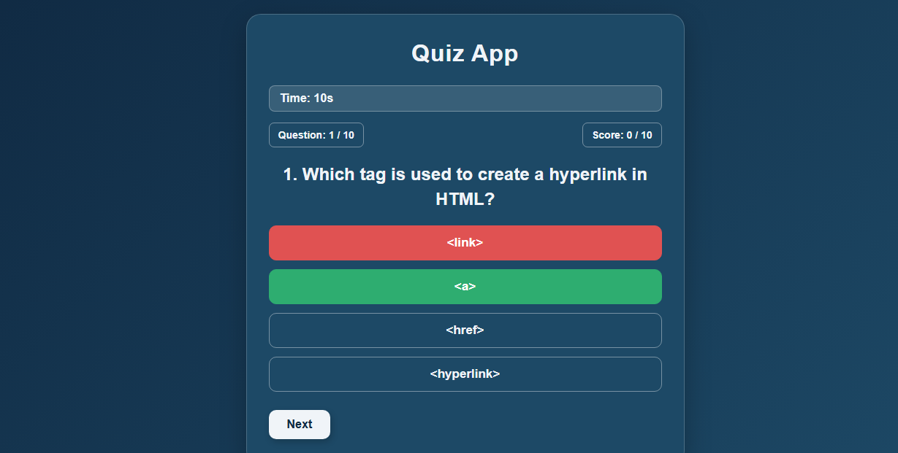
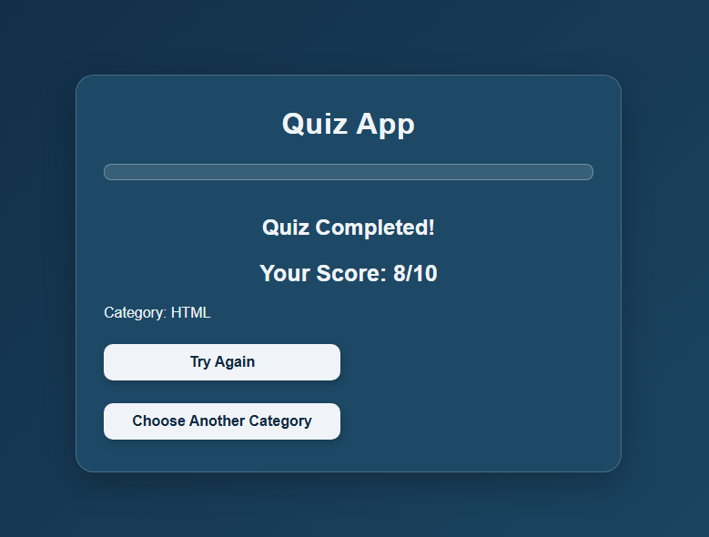

# Quiz App 🎯

A dynamic and responsive Quiz Application built using **HTML5, CSS3, and JavaScript (ES6)**. The application fetches trivia questions from an external API and allows users to test their knowledge through multiple-choice questions. It tracks scores, provides instant feedback, and saves high scores using Local Storage.

## 🌐 Live Demo

**[View Live Quiz App](https://quiz-app-by-kiran.vercel.app/)**

## 📂 GitHub Repository

**[View Source Code on GitHub](https://github.com/kiranverma321890-eng/quiz-app)**

## 🛠 Features

- Fetches dynamic trivia questions from an external API.
- Displays multiple-choice questions.
- Highlights correct and incorrect answers.
- Tracks the user's score.
- Automatically updates the question number.
- Displays the final score after completing the quiz.
- Saves high scores using Browser Local Storage.
- Allows users to restart the quiz.
- Responsive design for desktop and mobile devices.

## 📸 Screenshots

| Quiz Screen | Final Score Screen |
|:---:|:---:|
|  |   |

## 🚀 Getting Started

### 1. Clone the Repository

```bash
git clone https://github.com/kiranverma321890-eng/quiz-app.git
```

### 2. Navigate to the Project Directory

```bash
cd quiz-app
```

### 3. Run the Application

Open `index.html` in your web browser.

## 🗂 Project Structure

```text
quiz-app/
├── index.html
├── style.css
├── app.js
├── assets/
│   └── images/
│       ├── quick-screen.png
│       └── final-score-screen.png
└── README.md
```

## ✨ Technologies Used

- **HTML5** – Application structure.
- **CSS3** – Styling and responsive design.
- **JavaScript (ES6)** – Quiz functionality and application logic.
- **Trivia API** – Fetching quiz questions.
- **Local Storage** – Saving high scores in the browser.

## 📜 License

This project is open source and free to use. Feel free to modify and improve it.

